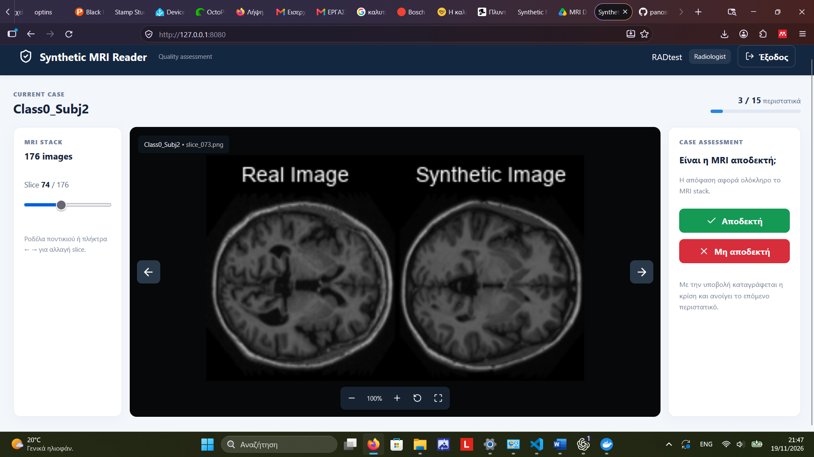
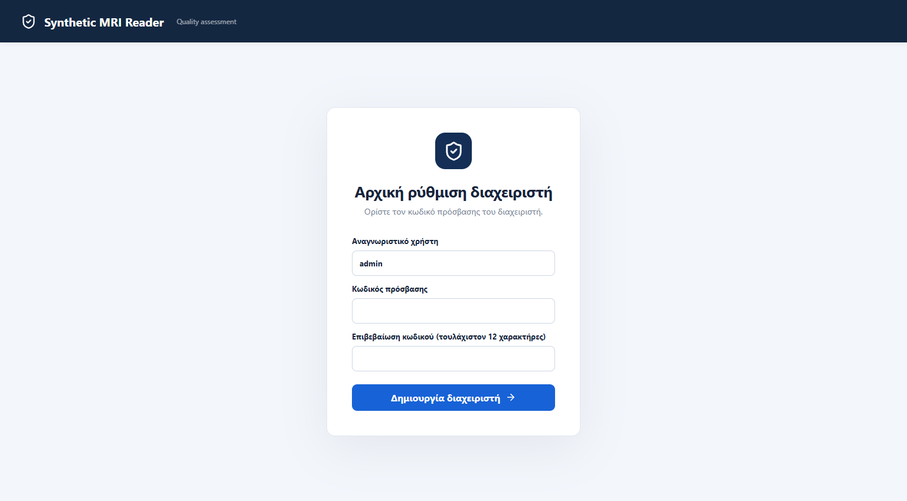
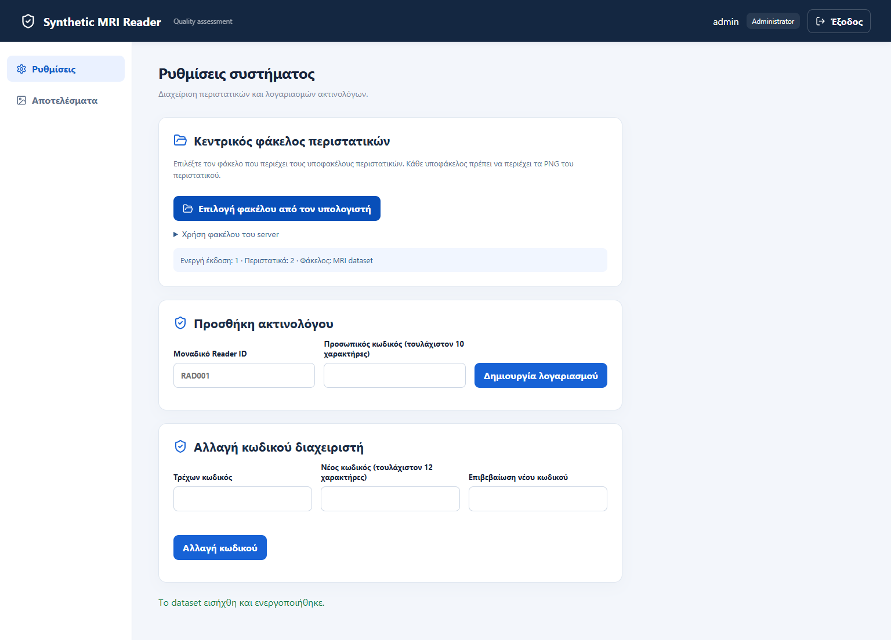
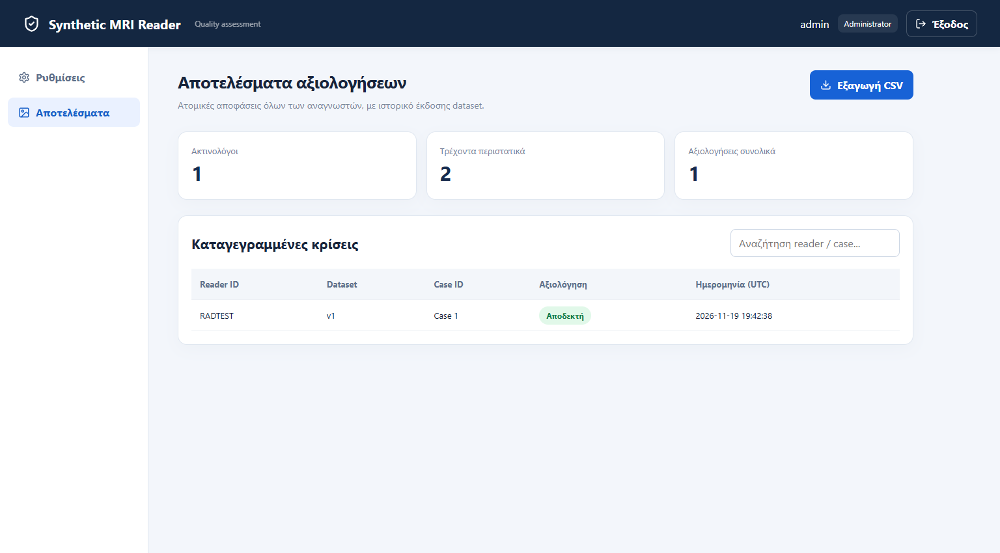

# Synthetic MRI Reader

A Greek-language web app for independent quality assessment of case-based MRI PNG stacks. Administrators import a dataset, create reader accounts, and export results. Readers review a complete image stack and record one accept or reject decision per case and dataset version.



The setup and admin screenshots below show a demonstration dataset and test accounts.

## Run with Docker

1. Start Docker Desktop in Linux container mode, or start Docker Engine with the Compose plugin.
2. From the project directory, run:

   ```sh
   docker compose up --build -d
   docker compose ps
   ```

3. Open [http://127.0.0.1:8080](http://127.0.0.1:8080) on the host.
4. On a fresh installation, **Αρχική ρύθμιση διαχειριστή** asks you to set and confirm the admin password. Use at least 12 characters. The default username is `admin`. Subsequent visits show the regular sign-in screen.



The default setup needs no `.env` file. To customize the port, bind address, initial admin username, or dataset mount, copy `.env.example` to `.env` and edit the settings. `ADMIN_USER` applies before the first admin account is created. Existing deployments retain their stored credentials.

## Import a dataset

1. Sign in as admin and open **Ρυθμίσεις** (Settings).
2. Click **Επιλογή φακέλου από τον υπολογιστή** (Choose folder from computer) and select the dataset root. PNGs must be directly inside the immediate case subfolders.
3. Confirm the import. The settings page shows upload progress and the case count after the new version is activated.

```text
my-dataset/
  Case_001/
    slice_001.png
    slice_002.png
  Case_002/
    slice_001.png
    slice_002.png
```

The folder can be anywhere accessible to your browser on the computer you're using. The app copies the PNGs into the Docker `reader_state` volume. Each PNG can be up to 64 MiB. Files sort numerically within the stack, so `slice_2.png` appears before `slice_10.png`.

If a dataset is already on the Docker host, set `MRI_HOST_PATH` in `.env` to its parent directory and run `docker compose up -d`. Then expand **Χρήση φακέλου του server** in Settings and enter the dataset root relative to the mount, such as `my-dataset`. The container mounts that directory read-only.



## Create readers and review cases

Under **Προσθήκη ακτινολόγου** (Add reader), create a unique Reader ID and an individual password of at least 10 characters. Reader IDs accept letters, digits, underscores, and hyphens. Readers sign in from the same app URL.

| Action | Viewer control |
| --- | --- |
| Browse slices | Scroll over the viewer, use the arrow keys or side buttons, or move the slice slider. |
| Fit and inspect | The viewer fits each slice while preserving its proportions. Use the zoom buttons, drag to pan, or select reset to restore the fit. |
| Fullscreen | Select the fullscreen icon below the image. |
| Submit a decision | Use **Αποδεκτή** (Accept) or **Μη αποδεκτή** (Reject) for the entire stack. |

The viewer preloads and caches nearby slices. After a reader submits a decision, the next unevaluated case opens automatically. Signing in again resumes from the reader's first unevaluated case in the active dataset. Each reader can submit one decision per case and dataset version.

## Export results and manage the admin password

Open **Αποτελέσματα** (Results) to review evaluations, filter by reader or case, or download a CSV. The export includes Reader ID, dataset version, case ID, verdict, and UTC submission time. Activating a new dataset version preserves previous evaluations in the results and export.



To change the admin password, open **Αλλαγή κωδικού διαχειριστή** in Settings. Enter your current password, then enter and confirm the new one. Your current session stays signed in and other admin sessions end. If you upgraded from a release that used `ADMIN_PASSWORD` in `.env`, you can remove that legacy entry after changing the password.

## Storage and operation

- **Persistence:** The `reader_state` Docker volume stores SQLite and imported images. `docker compose down` stops the app and preserves the volume. Removing the volume deletes the local accounts, evaluations, and imported images.
- **Updates:** From the project directory, run `docker compose up --build -d`.
- **Diagnostics:** Run `docker compose logs --tail 50 backend frontend` and check [the API health endpoint](http://127.0.0.1:8080/api/health). It returns `{"ok":true}` when the backend responds.
- **Network access:** Complete first-run setup on loopback before enabling access from other computers. For a controlled LAN deployment, configure `BIND_ADDRESS` with the host's LAN IP and use an HTTPS reverse proxy, institutional gateway, or private VPN as appropriate. Keep port 8080 off the public internet.

## Development

Run the FastAPI backend from `backend` with Python 3.11+:

```sh
pip install -r requirements.txt
export DB_PATH=./state/reader.db DATA_BASE_DIR=../sample-data
uvicorn app.main:app --reload
```

In PowerShell, set the two variables with `$env:DB_PATH = './state/reader.db'` and `$env:DATA_BASE_DIR = '../sample-data'`.

Run the React frontend from `frontend` with Node.js 20+:

```sh
npm install
npm run dev
```

Open [http://localhost:5173](http://localhost:5173). Vite proxies `/api` requests to port 8000. Run the backend workflow test from `backend` with `python -m pytest` after installing `pytest` and `httpx`.

## Research use

Use fully anonymized PNGs and case IDs, and keep dataset contents stable for the duration of a study. This research prototype operates on PNG stacks. It has no DICOM windowing, calibration, or orientation metadata and has not been validated for clinical diagnosis. Before deploying for a formal study, verify dataset integrity, session controls, backups, and institutional requirements.
